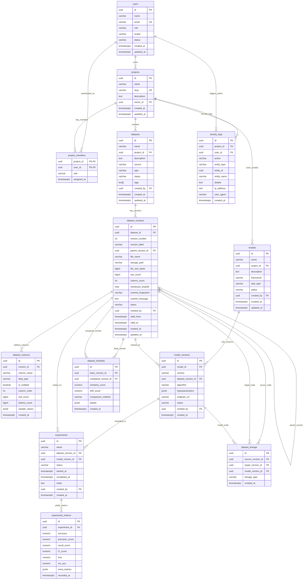

# DataForge — Relational Data Model & ER Diagram

## 1. Entity Relationship Diagram (Mermaid)

---

## 2. Integrity Constraints & Foreign Key Rules

| Entity | Constraint | Description |
|---|---|---|
| `users` | `users_email_key` | Email must be globally unique |
| `users` | `chk_user_role` | Allowed roles: ADMIN, DATA_ENGINEER, VIEWER |
| `projects` | `projects_slug_key` | URL-safe slug must be globally unique |
| `projects` | `projects_owner_id_fkey` | References `users(id)` ON DELETE RESTRICT |
| `project_members` | `project_members_pkey` | Composite PK `(project_id, user_id)` |
| `datasets` | `datasets_project_id_fkey` | References `projects(id)` ON DELETE CASCADE |
| `dataset_versions` | `uq_dataset_version_number` | Unique `(dataset_id, version_number)` |
| `dataset_versions` | `chk_version_number_positive`| `version_number > 0` |
| `dataset_versions` | `chk_no_self_parent` | `parent_version_id <> id` |
| `experiment_metrics`| `chk_metric_ranges` | Loss >= 0; accuracy, precision, recall, f1, auc between 0 and 1 |
| `dataset_similarity`| `chk_similarity_range` | `similarity_score BETWEEN 0.0 AND 1.0` |
| `dataset_similarity`| `chk_drift_range` | `drift_score >= 0.0` |

